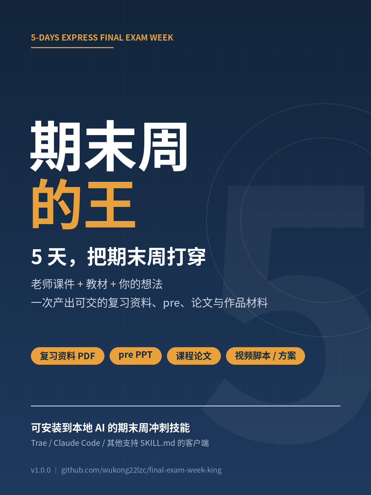

# 期末周的王：5天-快速-期末考试周



5-DAYS Express Final Exam Week ｜ 一个可安装到本地 AI 的期末周冲刺技能。

导入课程课件、教材信息和你自己的想法，一次产出：资料清单、复习资料 PDF、pre PPT、课程论文内容、视频脚本 / 实践方案等 Word 文档。适用于支持 `SKILL.md` 的本地 AI 客户端（Trae、Claude Code、Cursor 等），装好即用，不上传任何第三方服务器。

---

## 一、它解决什么问题

期末只剩五天！手上有：老师的课件、一本没怎么翻的教材、一个模糊的论文 idea、一个还没开始的 pre。

考什么、先做哪个、怎么在截止前交得出去，全都不知道，只能焦虑地玩手机……

这个技能按「建档 → 补料 → 考点地图 → 产出 → 质检」五步推进，并给出可执行的 5 天 / 3 天 / 24 小时计划。

## 二、输入什么

1. **重点资料**：老师课件、自己整理的重点（PPT / PDF / Word / JPG）
2. **课程书籍**：书名 + 作者（版次、ISBN 更好）
3. **其他资料**：学校、课程名与代码、老师姓名、本人/组员姓名、学号
4. **个人想法**：论文 idea、作品脚本 idea、PPT 风格、复习中最缺的部分

学号等信息只用于检索定位，产出中默认脱敏。

## 三、输出什么（可勾选）

| 交付物 | 内容 |
|---|---|
| 资料清单 | 重点资料摘要 → 书籍资料 → 其他资料 → 缺口与风险 |
| 复习资料 PDF | 考点地图、分章精要、题型模板、易错对照、速记卡、自测题、背诵计划 |
| pre PPT | 10–15 页结构 + 每页口播稿 + Q&A 预案 |
| 课程论文 | 只写内容：选题、摘要、正文、参考文献；不含格式与个人信息 |
| Word 其他 | 视频分镜表、实践调研方案、答辩稿、分工表、实验报告框架 |

## 四、安装

```bash
# Trae（项目级）
mkdir -p .trae/skills && cp -r <本仓库>/.trae/skills/final-exam-week-5days .trae/skills/

# Trae（用户级，所有项目可用）
mkdir -p ~/.trae/skills && cp -r <本仓库>/.trae/skills/final-exam-week-5days ~/.trae/skills/

# Claude Code
mkdir -p ~/.claude/skills && cp -r <本仓库>/.trae/skills/final-exam-week-5days ~/.claude/skills/
```

安装后确认目录里存在 `SKILL.md`，重启客户端即可。

其他支持 `SKILL.md` 的客户端：把 `final-exam-week-5days` 整个文件夹放进它的 skills 目录即可，无需改代码。

## 五、怎么用

直接把下面这段填好发给 AI：

```text
用期末周的王帮我准备这门课：
课程：传播学概论（课程代码 COMM101），XX大学，任课老师：李老师
类型：水课，考核 = 论文 50% + pre 30% + 平时 20%
剩余：5 天
要求：论文 4000 字、参考文献 10 篇、查重 ≤ 20%；pre 10 分钟
我上传了：老师 6 个课件、自己整理的 2 页重点
教材：《传播学教程》郭庆光
我的想法：想写短视频对大学生注意力的影响；pre 想做简洁学术风
最缺：第 5 章的受众理论
要：资料清单 + 复习资料 PDF + pre PPT + 论文内容
```

技能会先回一份「课程画像 + 缺口确认」，确认后按天推进。

完整示例见 [examples/demo-comm101](./examples/README.md)：一门虚构的传播学概论，输出复习资料 PDF、13 页 PPT、约 4000 字论文、分镜表 docx 与质检报告。

## 六、仓库结构

```text
.
├── README.md
├── assets/
│   ├── cover.png                 # 封面图
│   └── feature-long.png          # 说明长图（自媒体用）
├── examples/
│   └── demo-comm101/            # 完整示例（虚构课程，含 PDF / PPTX / DOCX）
└── .trae/skills/final-exam-week-5days/
    ├── SKILL.md                  # 主流程：建档、五天计划、交付规范、质检
    └── references/
        ├── intake.md             # 输入采集、文件读取、缺口追问
        ├── research.md           # 外部检索、来源分级、失败降级
        ├── outputs.md            # 四类交付物的模板与验收标准
        └── integrity.md          # 引用、查重、隐私、越界请求处理
```

## 七、发布与交付

- 仓库：`github.com/wukong22lzc/final-exam-week-king`
- 版本：`v1.0.0`，Release 附安装 zip
- 公开仓库用于展示与引流；付费 zip 可放在知识付费平台交付
- 授权建议：允许个人自用，禁止转售与二次分发；商用需单独授权

## 八、合规声明

本技能产出为学习辅助材料与初稿，不代考、不伪造文献与数据、不规避查重。使用者需自行核验事实与引用，并按所在学校的学术规范使用。

## 九、版本

v1.0.0（2026-10-20）：首版，覆盖水课 / 专业课 / 特殊课程三类场景。
